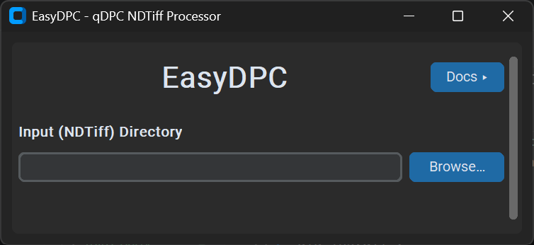
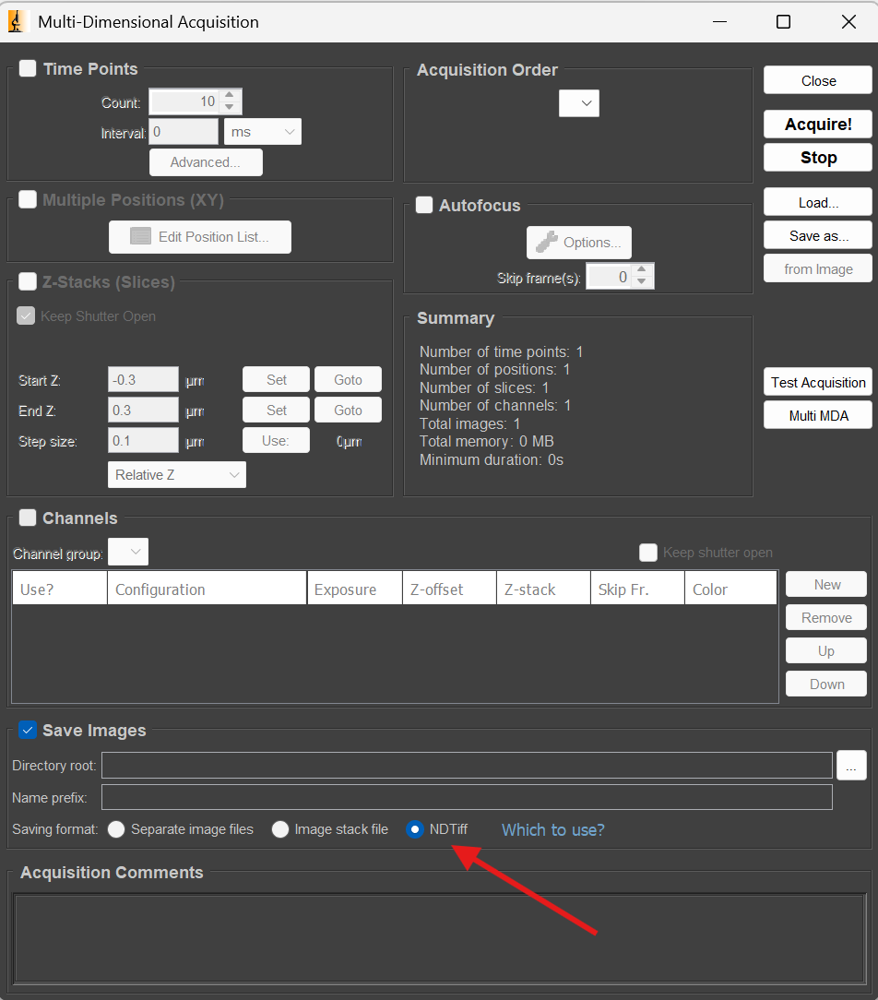
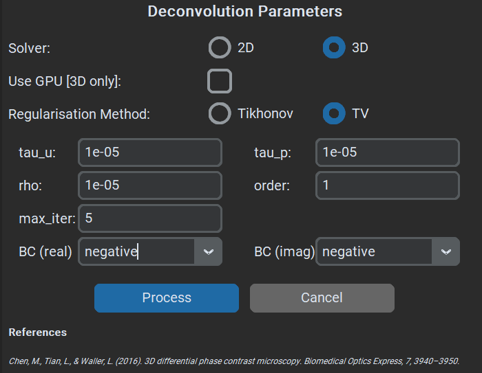
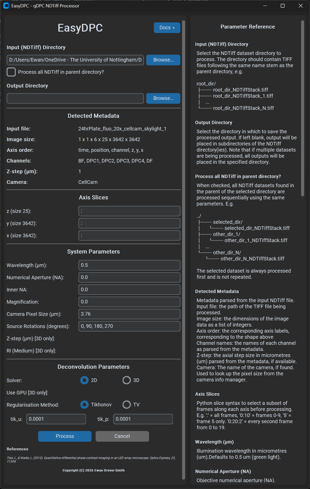

# EasyDPC

## What does EasyDPC do?
EasyDPC is a GUI fronted python program that enables quick and easy processing of quantitative differential phase contrast (qDPC) images from bulk NDTiff datasets. 

## Installation
EasyDPC requires a minimum Python version of 3.11.

Download or clone this repository and following the proceeding steps to install EasyDPC. When cloning the repository, pass the ```--recursive``` argument to ensure the submodules are also initialised.

All specified commands should be run in a console window from the root of this repository (folder containing pyproject.toml).

### A: Using Conda (or other environment manager)
```console
conda create --name easydpc-env python=3.11

conda activate easydpc-env

pip install .
```

For optional GPU support, run 
```console
pip install ".[gpu3d]"
```

### B: Using Python only (Not recommended)
It is recommended to create a fresh environment to install, but it is possible to install directly with python using. 

```console 
pip install .
```

**NB:** When done outside of an environment this will install all dependencies to your base Python environment, potentially causing conflicts with already installed modules.

## Running EasyDPC
After following the installation instructions, the EasyDPC GUI can be started by running the following command from within the install environment.

```console
easydpc-gui
```

This will open the initial screen of the GUI:



From here, the directory containing the NDTiff dataset to be processed can be selected. 

## Input format
In order to process qDPC images, EasyDPC expects that the input NDTiff dataset will contain a channels axis containing at least two DPC input images, which are those obtained by illuminating with an asymmetric illumination pattern (see [[1]](https://opg.optica.org/abstract.cfm?URI=oe-23-9-11394)). For automatic detection of the relevant channels, the channel names should be of the form: "DPC_#" where # denotes the rotation of the illumination pattern in degrees. In Micro-manager channel names are specified by the Config groups selected as channels during a multi-dimensional acquisition. Failing this, manual selection of the channels and their rotations is also supported within the GUI. 

### What is an NDTiff dataset?

NDTiff is an N-dimensional, multiresolution file format designed specifically for large, complex bio-imaging datasets.

It is one of the three options for saving output data from multi-dimensional acquisitions in [Micro-manager 2.0](https://micro-manager.org/). For large datasets (>10 GB) it is the superior option.



More information can be found at the following links:
- https://github.com/micro-manager/NDStorage
- https://micro-manager.org/Micro-Manager_File_Formats

## qDPC Algorithms
For processing the data, three algorithms from the [Waller Lab](https://github.com/Waller-Lab/) are utilised:
 - [DPC](https://github.com/Waller-Lab/DPC_withAberrationCorrection) - Reconstructs phase using Tikhonov Regularised deconvolution) [[1]](#references)
 - [Aberration-corrected DPC](https://github.com/Waller-Lab/DPC_withAberrationCorrection) - Jointly solves for complex-field and pupil aberration) [[2]](#references)
 - [3D DPC](https://github.com/Waller-Lab/3DQuantitativeDPC/) - Reconstructs 3D refractive index from through focus data  [[3]](#references)

 The DPC solver algorithm used in EasyDPC is dependent on the selection made in the _Deconvolution Params_ section of the GUI ([full GUI layout](#gui-layout)):

 

If the 2D solver is selected, the algorithm used is either: 
- DPC [[1]](#references) if __Tikhonov__ regularisation is selected
- Aberration-corrected DPC [[2]](#references) if __TV__ (Total variation) regularisation is selected

Else, if the 3D solver is selected, the 3D DPC algorithm(s) [[3]](#references) are used.

## GUI Layout



## Sample Data

A sample dataset is included in [Sample Data](./Sample%20Data/easydpc_sample_dataset/). For processing this dataset, the following system parameters should be used:
- Wavelength = 0.5
- Numerical Aperture = 0.4
- Inner NA = 0.0
- Magnification = 20.0
- Camera Pixel Size = 3.69
- Source Rotations = 270, 180, 90, 0
- Z-step = 1.0
- RI (medium) = 1.33 

## Troubleshooting

If when running the app you are presented the following error ```ModuleNotFoundError: No module named 'EasyDPC.third_party'```, this is likely caused by missing dependencies in the EasyDPC/third_party/WallerLab directory. Run ```git submodule update --init --recursive``` to initialise the submodules or manually download the code from the linked repositories.

# References
[1] [L. Tian and L. Waller, ‘Quantitative differential phase contrast imaging in an LED array microscope’, Opt. Express, vol. 23, no. 9, p. 11394, May 2015, doi: 10.1364/OE.23.011394.](https://doi.org/10.1364/OE.23.011394)

[2] [M. Chen, Z. F. Phillips, and L. Waller, ‘Quantitative differential phase contrast (DPC) microscopy with computational aberration correction’, Opt. Express, vol. 26, no. 25, p. 32888, Dec. 2018, doi: 10.1364/OE.26.032888.](https://doi.org/10.1364/OE.26.032888)

[3] [M. Chen, L. Tian, and L. Waller, ‘3D differential phase contrast microscopy’, Biomed. Opt. Express, BOE, vol. 7, no. 10, pp. 3940–3950, Oct. 2016, doi: 10.1364/BOE.7.003940.](https://doi.org/10.1364/BOE.7.003940)

